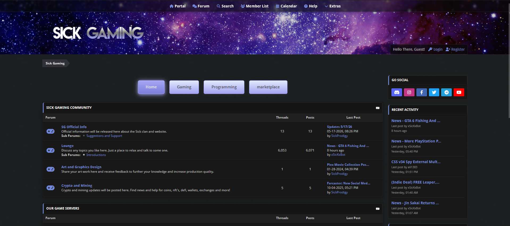

# Space Cadet Theme for MyBB

Space Cadet is a MyBB 1.8.41 child theme built from the open-source MyBB Master Style. The complete stock theme is retained as a versioned reference, while the importable release contains only intentional Space Cadet overrides.



## Repository Structure

```text
upstream/mybb-1.8.41/
├── mybb_theme.xml          # untouched official master theme
└── theme_parts/
    ├── properties.xml
    ├── stylesheets/        # 7 stock stylesheets
    └── templates/          # 971 stock templates
theme_overrides/
├── properties.xml
├── stylesheets/            # Space Cadet additions or replacements
└── templates/              # modified stock templates only
images/space-cadet/
├── fontawesome/             # self-hosted Font Awesome Free Solid and Brands assets
└── fonts/droid-sans/        # local Droid Sans webfonts and Apache 2.0 license
scripts/
├── split_theme.py
└── assemble_theme.py
theme.json                  # project and compatibility metadata
space-cadet-theme.xml       # generated minimal import file
```

Treat everything under `upstream/` as read-only. Do not edit the generated `space-cadet-theme.xml` directly.

## Installation

Space Cadet requires MyBB 1.8.41. Use the generated `space-cadet-theme.xml` for the theme import; do not import the upstream XML or individual override fragments.

1. Copy the repository's `images/space-cadet/` directory to `images/space-cadet/` under the MyBB forum root. Keep the included Font Awesome and Droid Sans files in their existing subdirectories.
2. In MyBB Admin CP, open **Templates & Style → Themes → Import a Theme**.
3. Select `space-cadet-theme.xml`, give the theme a name if desired, and import it. Leave **Ignore Version Compatibility** disabled when installing on MyBB 1.8.41.
4. Set Space Cadet as the default theme or select it for the test account under **User CP → Edit Options**.
5. Confirm the imported theme inherits unchanged components from **MyBB Master Style**. Do not detach or copy all master templates into Space Cadet.
6. Hard-refresh the browser and clear any proxy/CDN cache, then test the index, forum and thread listings, search results, member list and profiles, calendar views, private messages, and moderation pages on desktop and mobile.

For upgrades, replace `images/space-cadet/` with the release assets and import the new generated XML. Test upgrades on a non-production forum first; importing may create a separate theme instead of overwriting an existing customized installation.

## Contributing

See [CONTRIBUTING.md](CONTRIBUTING.md) for the development workflow, build commands, upstream refresh instructions, and versioning guidance.

## Texture Credits

The optional repeating background textures under `images/space-cadet/backgrounds/` are sourced from Transparent Textures and used under the Creative Commons Attribution 3.0 license:

- `black-felt.png` by E. van Zummeren
- `scbg.png` by Atle Mo
- `asfalt-dark.png` by Atle Mo
- `tactile-noise-dark.png` by Atle Mo
- `dark-geometric.png` by Mike Warner
- `dark-matter.png` by Atle Mo
- `graphy-dark.png` by We Are Pixel8
- `shattered-dark.png` by Luuk van Baars
- `diagmonds.png` by INS
- `hexellence.png` by Kim Ruddock

Source: https://www.transparenttextures.com/
License: https://creativecommons.org/licenses/by/3.0/

## License

Copyright 2026 SickProdigy.

The original Space Cadet theme code and assets are licensed under the GNU General Public License, version 3, with an additional attribution-preservation term permitted by section 7(b). Redistributions and modified versions must preserve the specified Space Cadet attribution in the theme footer, or in another prominent location in the theme interface if the work has no footer. A separate commercial license permitting removal of that attribution is available from SickProdigy. See [LICENSE](LICENSE) for the complete terms.

The MyBB-derived baseline and bundled third-party components remain under their respective licenses. Retain all applicable MyBB, Font Awesome, Droid Sans, and texture copyright, license, and attribution notices.
